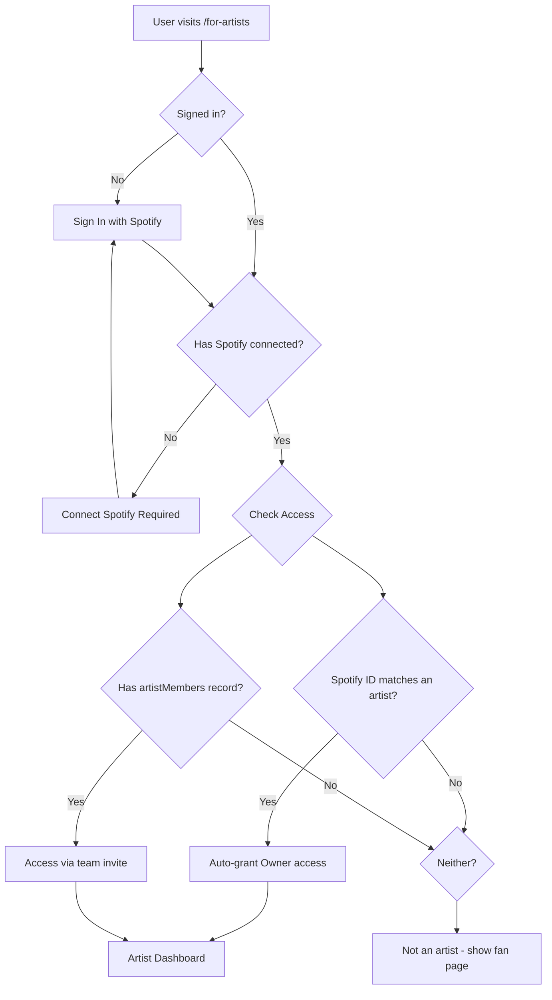

# Artist Platform Architecture Plan

> **Superseded:** This proposal's Spotify user-ID-to-artist-ID ownership match
> is not valid and is not the implemented trust model. Use
> [`docs/artist-claims-and-team-access.md`](../docs/artist-claims-and-team-access.md)
> for current claim, verification, membership, and invitation behavior.

## Executive Summary

Enable artists to access their fan demand dashboard by signing in with their official Spotify artist account. The system automatically matches Spotify artist IDs - no manual claims or verification needed. Band members can be invited by verified artists.

---

## 1. How It Works (Simplified)

### The Core Logic



### Two Ways to Get Access

| Method | How it Works | Role |
|--------|--------------|------|
| **Direct Match** | User's Spotify account IS the artist account | Owner |
| **Team Invite** | Existing owner invites them via email | Manager/Viewer |

That's it. No claims. No evidence. No manual review.

---

## 2. Technical Implementation

### 2.1 The Matching Logic

When a user with Spotify connected visits `/for-artists`:

```typescript
// convex/artistAccess.ts

export const getMyArtistAccess = query({
  args: {},
  handler: async (ctx) => {
    const user = await getCurrentAppUser(ctx);
    if (!user) return { hasAccess: false, reason: "not_signed_in" };
    if (!user.spotifyId) return { hasAccess: false, reason: "no_spotify" };

    // Method 1: Direct Spotify artist match
    const ownedArtist = await ctx.db
      .query("artists")
      .withIndex("by_spotify_id", (q) => q.eq("spotifyId", user.spotifyId))
      .first();

    if (ownedArtist) {
      // Auto-create artistMembers record if not exists
      const existingMembership = await ctx.db
        .query("artistMembers")
        .withIndex("by_user_artist", (q) => 
          q.eq("userId", user._id).eq("artistId", ownedArtist._id)
        )
        .first();

      if (!existingMembership) {
        await ctx.db.insert("artistMembers", {
          userId: user._id,
          artistId: ownedArtist._id,
          role: "owner",
          createdAt: Date.now(),
        });
      }

      return {
        hasAccess: true,
        artists: [{ artist: ownedArtist, role: "owner" }],
      };
    }

    // Method 2: Team member invite
    const memberships = await ctx.db
      .query("artistMembers")
      .withIndex("by_user", (q) => q.eq("userId", user._id))
      .collect();

    if (memberships.length > 0) {
      const artistsWithRoles = await Promise.all(
        memberships.map(async (m) => ({
          artist: await ctx.db.get(m.artistId),
          role: m.role,
        }))
      );
      return { hasAccess: true, artists: artistsWithRoles.filter(a => a.artist) };
    }

    // No access
    return { hasAccess: false, reason: "not_an_artist" };
  },
});
```

### 2.2 The Key Insight

Your `artists` table already has `spotifyId` field populated from Spotify API data. When an artist signs in with the **same Spotify account that owns their artist profile**, the IDs match automatically.

**Example:**
- Artist "The Band" has Spotify artist ID: `spotify:artist:abc123`
- Band manager signs in with Spotify, their user ID is: `spotify:user:abc123` (same account)
- Match! → Instant access

### 2.3 Team Member Invites

For band members who don't own the Spotify artist account:

```typescript
// convex/artistAccess.ts

export const inviteTeamMember = mutation({
  args: {
    artistId: v.id("artists"),
    email: v.string(),
    role: v.union(v.literal("manager"), v.literal("viewer")),
  },
  handler: async (ctx, args) => {
    // Verify caller is owner of this artist
    const { membership } = await requireArtistAccess(ctx, args.artistId, "owner");

    // Find user by email (they must have signed up already)
    const invitee = await ctx.db
      .query("users")
      .withIndex("by_email", (q) => q.eq("email", args.email))
      .first();

    if (!invitee) {
      throw new Error("User not found. They need to sign up first.");
    }

    // Check if already a member
    const existing = await ctx.db
      .query("artistMembers")
      .withIndex("by_user_artist", (q) => 
        q.eq("userId", invitee._id).eq("artistId", args.artistId)
      )
      .first();

    if (existing) {
      throw new Error("User is already a team member");
    }

    // Create membership
    await ctx.db.insert("artistMembers", {
      userId: invitee._id,
      artistId: args.artistId,
      role: args.role,
      createdAt: Date.now(),
      invitedBy: membership.userId,
    });

    return { success: true };
  },
});
```

---

## 3. Frontend Flow

### 3.1 Routes

```
/for-artists                    → Landing + access check
/for-artists/:artistId          → Artist dashboard (shows, demand overview)
/for-artists/:artistId/shows/:showId → Show demand detail
/for-artists/:artistId/team     → Team management (owner only)
```

### 3.2 Landing Page Logic

```tsx
// src/pages/ForArtistsPage.tsx

export function ForArtistsPage() {
  const { user, isLoaded } = useUser();
  const access = useQuery(api.artistAccess.getMyArtistAccess);
  const navigate = useNavigate();

  // Loading
  if (!isLoaded || access === undefined) {
    return <LoadingSpinner />;
  }

  // Not signed in
  if (!user) {
    return (
      <SpotifySignInPrompt 
        message="Sign in with your Spotify artist account to access your dashboard"
      />
    );
  }

  // No Spotify connected
  if (access.reason === "no_spotify") {
    return (
      <SpotifyConnectPrompt 
        message="Connect your Spotify artist account to continue"
      />
    );
  }

  // Has access - redirect to dashboard
  if (access.hasAccess && access.artists?.length > 0) {
    // If single artist, go directly to their dashboard
    if (access.artists.length === 1) {
      return <Navigate to={`/for-artists/${access.artists[0].artist._id}`} />;
    }
    // Multiple artists - show selection
    return <ArtistSelectionPage artists={access.artists} />;
  }

  // Not an artist
  return (
    <NotAnArtistPage 
      message="This portal is for verified Spotify artists. If you manage an artist, ask the account owner to invite you."
    />
  );
}
```

### 3.3 The User Experience

**Scenario A: Artist signs in with their official Spotify**
1. Visit `/for-artists`
2. Click "Sign in with Spotify"
3. Spotify OAuth → back to app
4. Automatic match detected → straight to dashboard
5. Done in < 5 seconds

**Scenario B: Band member invited by owner**
1. Owner invites them via email in team settings
2. Band member signs up with their own Spotify
3. Visit `/for-artists`
4. Already has `artistMembers` record → straight to dashboard

**Scenario C: Fan tries to access**
1. Visit `/for-artists`
2. Sign in with Spotify
3. No match, no invite → "This is for verified artists"

---

## 4. Schema (Minimal Changes)

### 4.1 artistMembers Table (Already Exists)

```typescript
artistMembers: defineTable({
  artistId: v.id("artists"),
  userId: v.id("users"),
  role: v.union(v.literal("owner"), v.literal("manager"), v.literal("viewer")),
  createdAt: v.number(),
  invitedBy: v.optional(v.id("users")), // NEW: track who invited
})
  .index("by_artist", ["artistId"])
  .index("by_user", ["userId"])
  .index("by_user_artist", ["userId", "artistId"])
```

### 4.2 Delete artistClaims?

The `artistClaims` table is no longer needed with this simplified flow. Consider:
- Keep it for now (empty anyway)
- Remove it in a future cleanup

---

## 5. Dashboard Features

### 5.1 What Artists See

```
/for-artists/:artistId
├── Overview
│   ├── Total votes across all shows
│   ├── Top 5 requested songs (all-time)
│   └── Upcoming shows list
│
├── Click on a show →
│   /for-artists/:artistId/shows/:showId
│   ├── Song demand ranking for THIS show
│   ├── Vote counts per song
│   └── Export setlist button
│
└── Team (owner only)
    /for-artists/:artistId/team
    ├── Current team members
    ├── Invite by email
    └── Remove members
```

### 5.2 Demand Data (Already Built)

The [`artistDashboard.ts`](../convex/artistDashboard.ts) already has:
- `getArtistHome` - upcoming shows for an artist
- `getShowDemand` - song demand for a specific show

These work with `showSongDemand` table. Need to ensure votes populate this table (via cron or mutation trigger).

---

## 6. Implementation Checklist

### Phase 1: Core Access System
- [ ] Update `artistAccess.ts` with `getMyArtistAccess` query
- [ ] Add auto-creation of `artistMembers` on Spotify match
- [ ] Create `inviteTeamMember` mutation
- [ ] Create `removeTeamMember` mutation

### Phase 2: Frontend Pages
- [ ] Rename `/studio` routes to `/for-artists`
- [ ] Update `ForArtistsLandingPage` with access check logic
- [ ] Add "Not an artist" page
- [ ] Create team management page (`/for-artists/:artistId/team`)

### Phase 3: Dashboard Enhancements
- [ ] Ensure `showSongDemand` table is populated (cron or trigger)
- [ ] Add setlist export/download feature
- [ ] Polish demand visualization

### Phase 4: Polish
- [ ] Email notifications when invited to team
- [ ] First-time welcome for new artists
- [ ] Mobile responsive adjustments

---

## 7. Edge Cases

| Scenario | Behavior |
|----------|----------|
| User not signed in | Show Spotify sign-in prompt |
| Signed in but no Spotify | Show Spotify connect prompt |
| Spotify connected but no match | "Not an artist" page |
| Artist has no upcoming shows | Dashboard shows "No upcoming shows" |
| Artist not in our system yet | They're not in Ticketmaster/trending - can't help them |
| Owner removes themselves | Prevent via UI (owner can't remove self) |
| Multiple artists same Spotify ID | Unlikely, but handle gracefully |

---

## 8. Security

### Access Control Helper

```typescript
async function requireArtistAccess(
  ctx: QueryCtx | MutationCtx,
  artistId: Id<"artists">,
  minimumRole: "viewer" | "manager" | "owner" = "viewer"
): Promise<{ user: User; membership: ArtistMember }> {
  const user = await getCurrentAppUser(ctx);
  if (!user) throw new Error("Sign in required");

  const membership = await ctx.db
    .query("artistMembers")
    .withIndex("by_user_artist", (q) => 
      q.eq("userId", user._id).eq("artistId", artistId)
    )
    .first();

  if (!membership) throw new Error("No access to this artist");

  const roleLevel = { viewer: 0, manager: 1, owner: 2 };
  if (roleLevel[membership.role] < roleLevel[minimumRole]) {
    throw new Error(`Requires ${minimumRole} access`);
  }

  return { user, membership };
}
```

### Role Permissions

| Action | Viewer | Manager | Owner |
|--------|--------|---------|-------|
| View dashboard | ✓ | ✓ | ✓ |
| View show demand | ✓ | ✓ | ✓ |
| Export setlist | ✓ | ✓ | ✓ |
| Invite team members | ✗ | ✗ | ✓ |
| Remove team members | ✗ | ✗ | ✓ |

---

## Summary

**Before:** Complex claim system with evidence, tiers, admin review
**After:** Sign in with Spotify → instant access if you're the artist

The beauty of this approach:
1. **Zero friction** for real artists
2. **Impossible to fake** (can't fake Spotify artist ownership)
3. **Team support** via simple email invites
4. **No admin overhead** (no claims to review)
